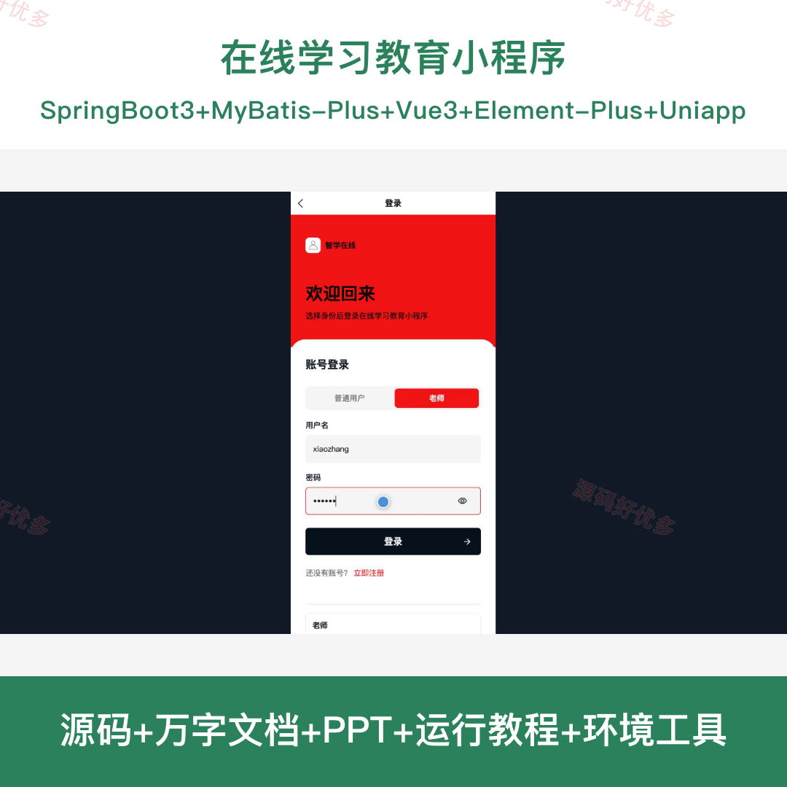
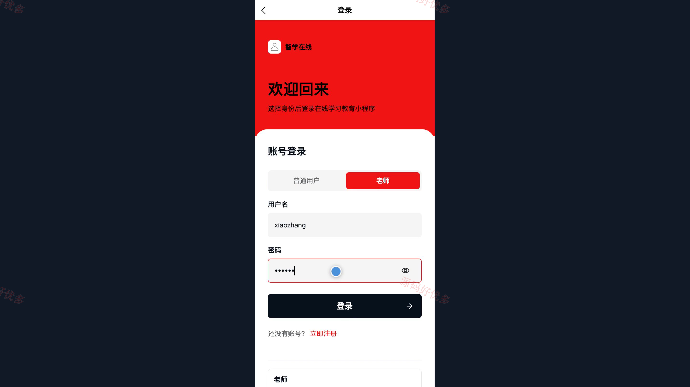
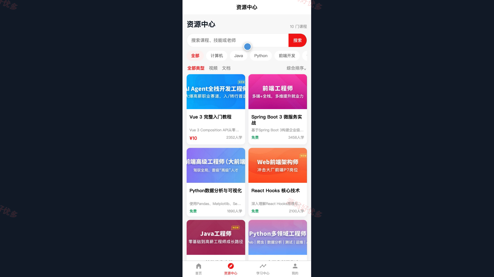
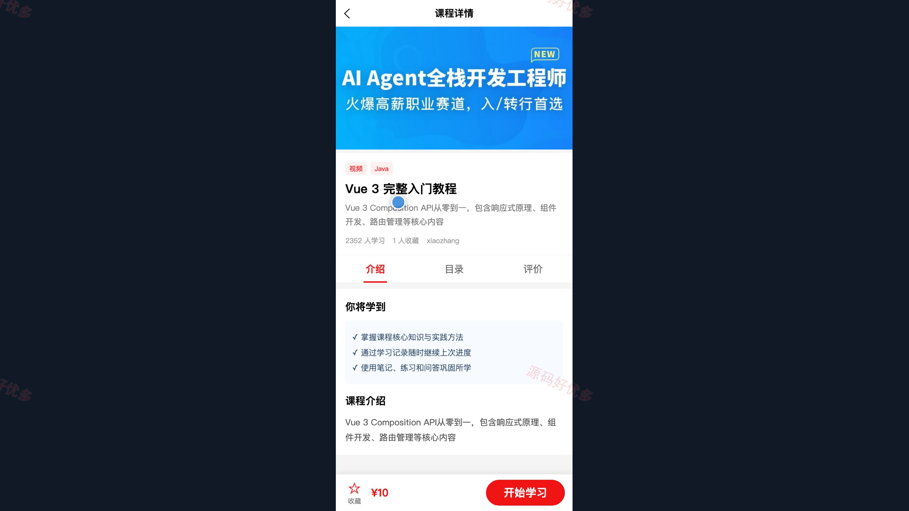
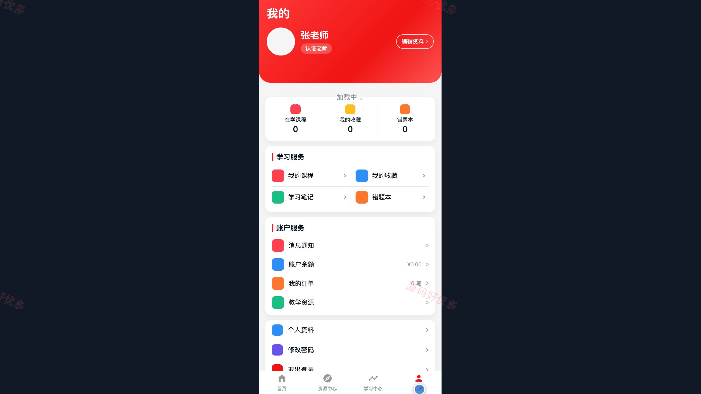
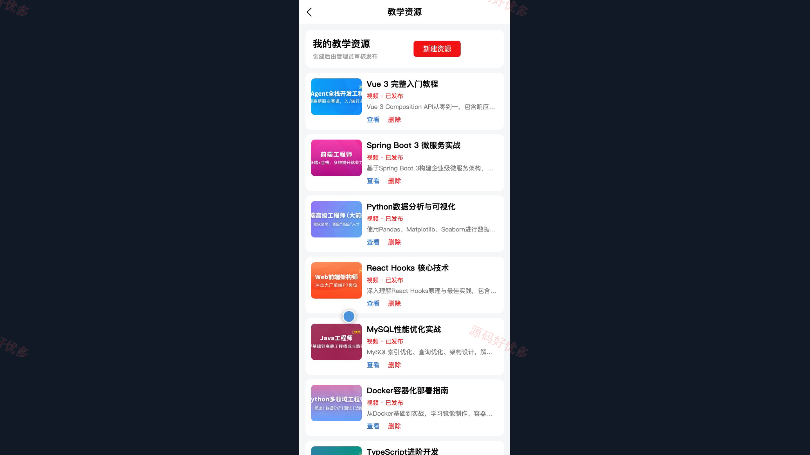
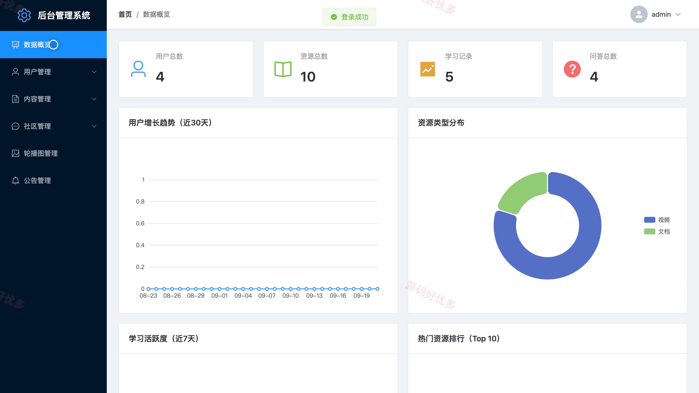
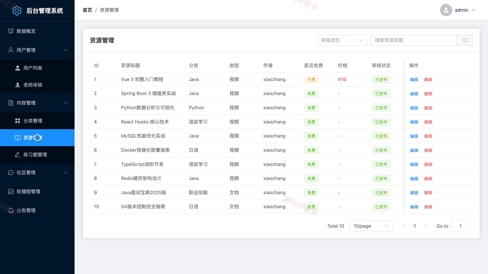
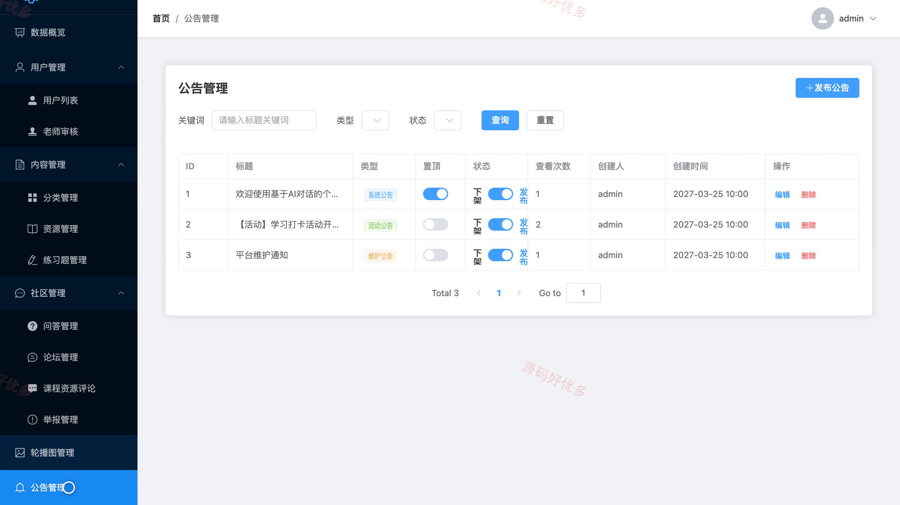

# bs126B
bs126B在线学习教育平台
## 源码问题查看主页咨询

### 一、关键词
在线学习小程序、课程资源学习、教学资源管理、练习题库、学习论坛

### 二、作品包含
源码+数据库+万字设计文档+PPT+全套环境和工具资源+本地部署教程

### 三、项目技术
前端技术： Html、Css、Js、Vue3.4、Element-Plus、uniapp
后端技术：Java、SpringBoot3.1.5、MyBatis-Plus

### 四、运行环境要求
开发工具：IDEA/eclipse + VSCODE + HBuilder X + 微信开发者工具

数据库：MySQL5.7（共28张表）

数据库管理工具：Navicat10以上版本

环境配置软件： JDK17 + Maven3.6

前端Nodejs：16+

浏览器：谷歌浏览器

### 五、项目介绍
项目编号：bs126B

在线学习教育小程序由学习者和老师使用的小程序端、管理员使用的 Web 后台及 Spring Boot 服务组成。学习者可浏览课程资源、记录学习、收藏课程、参与练习与论坛问答；老师可创建教学资源并提交审核；管理员可审核老师与教学资源，管理分类、题目、用户和公告。

角色：普通用户、老师、管理员

普通用户功能：课程资源浏览、学习记录与学习笔记、课程收藏、练习题与错题本、学习论坛与问答、消息通知、AI 学习助手。

老师功能：教学资源创建与提交审核、个人教学资源查看与删除、课程资源浏览、学习论坛与问答。

管理员功能：数据概览、用户与老师审核、课程分类与教学资源管理、练习题与问答管理、论坛评论与举报管理、轮播图与公告管理。

### 六、运行截图

